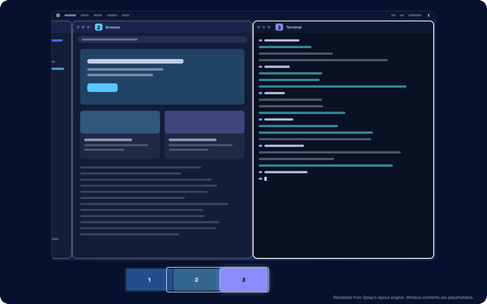
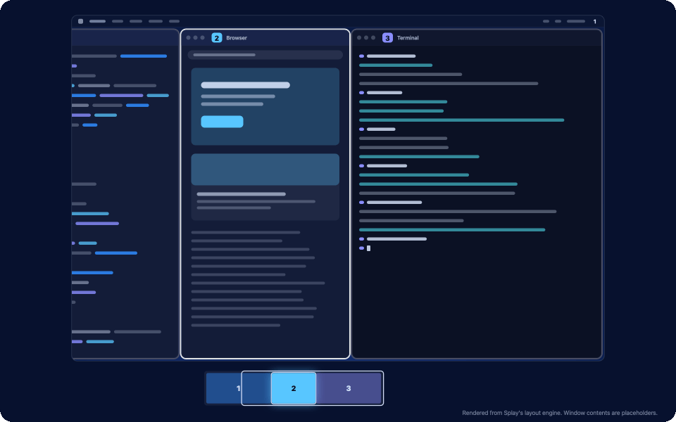
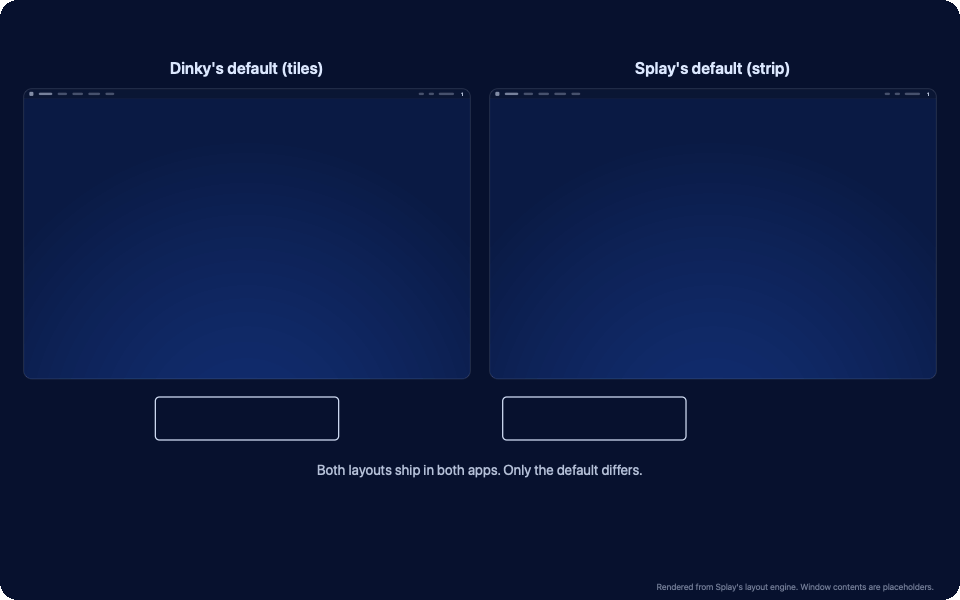

<p align="center">
  
</p>

<h1 align="center">Splay</h1>

<p align="center">
  A tiling window manager for macOS that lays out each Space as one scrolling strip of columns.<br>
  Built on <a href="https://github.com/mikker/Dinky">Dinky</a>. System Integrity Protection stays on.
</p>

<p align="center">
  <a href="#status-and-limits"></a>
  
  <a href="LICENSE"></a>
  
  <a href="https://github.com/mikker/Dinky"></a>
</p>

<p align="center">
  <a href="#build-and-run">Build it</a> ·
  <a href="https://shawntz.github.io/splay/">Website</a> ·
  <a href="https://shawntz.github.io/splay/start/">Manual</a> ·
  <a href="https://shawntz.github.io/splay/layouts/">Layouts</a> ·
  <a href="https://shawntz.github.io/splay/configuration/">Configuration</a> ·
  <a href="https://shawntz.github.io/splay/commands/">Commands</a> ·
  <a href="https://shawntz.github.io/splay/changelog/">Changelog</a>
</p>

<p align="center">
  <picture>
    <source media="(prefers-reduced-motion: reduce)" srcset="docs/assets/demo/strip-poster.png">
    
  </picture>
  <br>
  <sub>Rendered from Splay's layout engine. Window contents are placeholders. <a href="docs/assets/demo/strip.mp4">MP4, 1920x1200</a></sub>
</p>

Splay is a tiling window manager for macOS. It lays out the windows on each Space as one row of
columns that runs past the edges of the display and scrolls sideways. A new window opens as a column
to the right of the focused one, instead of splitting the space the others share.
<kbd>Cmd</kbd>+<kbd>←</kbd> and <kbd>Cmd</kbd>+<kbd>→</kbd> move focus along the row, and the row
scrolls just far enough to show the focused column whole. System Integrity Protection stays on, and
nothing is injected into the Dock.

Splay is a fork of [Dinky](https://github.com/mikker/Dinky) by Mikkel Malmberg, and almost all of
its code is Dinky's, the scrolling layout included. Dinky ships that layout as an option. Splay makes
it the default, binds <kbd>Cmd</kbd> and the arrow keys to walk it, and adds column commands modelled
on niri's: preset widths, an exact width, maximize, centring, and jumping to the first or last
column. Thank you, Mikkel.

> [!NOTE]
> Splay builds and passes its tests on macOS 27. So far it has run on one Mac, its author's, starting
> on 2026-11-15.
> There are no releases, so you build it from source. [Status and limits](#status-and-limits) has
> the details.

## What it does

### Walk the strip

<kbd>Cmd</kbd>+<kbd>←</kbd> and <kbd>Cmd</kbd>+<kbd>→</kbd> focus the column to the left or right,
as in the animation above. <kbd>Cmd</kbd>+<kbd>Home</kbd> and <kbd>Cmd</kbd>+<kbd>End</kbd> jump to
the first and last column. Focus lands on the window you last used in that column, so leaving a
column of stacked windows and coming back returns you to the same window. <kbd>Alt</kbd>+<kbd>J</kbd>
and <kbd>Alt</kbd>+<kbd>K</kbd> move focus within a column, and <kbd>Alt</kbd>+<kbd>Shift</kbd> with
<kbd>H</kbd>, <kbd>J</kbd>, <kbd>K</kbd> or <kbd>L</kbd> moves the window. Alt is the Option key.

Columns out of view hang off the screen edge with 25 points showing, because macOS can't clip
another app's window. `peek` in `[scrolling]` sets that sliver, from 1 to 100 points. When a column
elsewhere in the strip closes or changes width, the column you are looking at stays where it is on
screen, as far as the ends of the strip allow.

### Size and centre columns

<p align="center">
  <picture>
    <source media="(prefers-reduced-motion: reduce)" srcset="docs/assets/demo/widths-poster.png">
    
  </picture>
  <br>
  <sub>Rendered from Splay's layout engine. Window contents are placeholders. <a href="docs/assets/demo/widths.mp4">MP4, 1920x1200</a></sub>
</p>

<kbd>Alt</kbd>+<kbd>R</kbd> steps the focused column through preset widths, a third, a half and two
thirds of the display, and wraps around. <kbd>Alt</kbd>+<kbd>Shift</kbd>+<kbd>R</kbd> steps back.
<kbd>Alt</kbd>+<kbd>M</kbd> widens the column to fill the display, leaving the slivers at its edges,
and a second press gives back the width it had. The column stays wide while you work in other
columns. <kbd>Alt</kbd>+<kbd>C</kbd> centres the column and keeps it centred until focus moves to
another column.

`column-width 0.75` sets an exact share of the display, from a key, the command line or a window
rule. In `[scrolling]`, `center-focused-column = 'always'` centres each column as focus
reaches it, `'on-overflow'` does so only when the column would not fit beside its neighbour, and
`preset-column-widths` sets the steps. <kbd>Alt</kbd>+<kbd>Minus</kbd> and
<kbd>Alt</kbd>+<kbd>Equal</kbd> still resize a column by 50 points, as in Dinky, and you can still
drag a column's edge.

### Workspaces are Spaces

<p align="center">
  <picture>
    <source media="(prefers-reduced-motion: reduce)" srcset="docs/assets/demo/workspaces-poster.png">
    
  </picture>
  <br>
  <sub>Rendered from Splay's layout engine. Window contents are placeholders. This part is Dinky's, unchanged. <a href="docs/assets/demo/workspaces.mp4">MP4, 1920x1200</a></sub>
</p>

Each workspace is a native macOS Space with its own strip. There are 5 unless `workspaces` in the
config says otherwise. <kbd>Ctrl</kbd>+<kbd>←</kbd> and <kbd>Ctrl</kbd>+<kbd>→</kbd> switch
workspace, <kbd>Alt</kbd>+<kbd>1</kbd> to <kbd>9</kbd> go to one, and
<kbd>Alt</kbd>+<kbd>Shift</kbd>+<kbd>1</kbd> to <kbd>9</kbd> send the focused window there.
Cmd-Tab and Dock clicks switch to the workspace of the app you picked.

All of this is Dinky's work. It switches Spaces with a synthetic Dock swipe and a few private
SkyLight calls. Dinky's manual says that takes about 70 ms instead of half a second. Splay runs the
same code, but nobody has timed it.

### Script it

Splay keeps Dinky's command line, socket, hooks and window rules. The column commands work on the
command line and in window rules too.

```sh
splay column-width 0.66            # the focused column at two thirds of the display
splay focus-column last
splay list-windows --workspace 3
```

A window rule acts on the window it matched, so it can open an app's windows at a set width:

```toml
[[rules]]
app-id = 'com.apple.Safari'
run = 'column-width 0.66'
```

Hooks hand bars such as SketchyBar the workspace, display and mode in `SPLAY_*` variables.
[Commands](https://shawntz.github.io/splay/commands/) covers the command line and scripting, and
[Configuration](https://shawntz.github.io/splay/configuration/) covers every key.

### Other layouts

Dinky's other layouts are all here: dwindle, fixed grids and master, and tiles and accordion modes
for a column or a container. Set one per workspace, or switch with `workspace-layout`.
`default-layout = 'tiles'` makes Dinky's dwindle the default again.

## Splay and Dinky

Dinky did the hard part. It has the scrolling layout too, added in version 0.16 and modelled on niri
and Hyprland, with column widths, slivers at the edges, column moves, joins, resizing and drag-resize.
Splay changes the defaults and adds column commands on top. What this section says about Dinky
describes its repository at the commit Splay forked from.

<p align="center">
  <picture>
    <source media="(prefers-reduced-motion: reduce)" srcset="docs/assets/demo/versus-poster.png">
    
  </picture>
  <br>
  <sub>Rendered from Splay's layout engine, which is Dinky's. Window contents are placeholders. Both layouts ship in both apps. Only the default differs. <a href="docs/assets/demo/versus.mp4">MP4, 1920x1200</a></sub>
</p>

| | Splay | Dinky |
| --- | --- | --- |
| Default layout | The scrolling strip | Dwindle, called `tiles`. `default-layout = 'scrolling'` gives the strip. |
| Focus the next column | <kbd>Cmd</kbd>+<kbd>←</kbd> or <kbd>→</kbd> | <kbd>Alt</kbd>+<kbd>H</kbd> or <kbd>L</kbd> |
| First or last column | <kbd>Cmd</kbd>+<kbd>Home</kbd> or <kbd>End</kbd> | No command |
| Column width | Preset steps, an exact share, 50-point steps, dragging an edge | 50-point steps, dragging an edge |
| One column across the display | `maximize-column`, which holds while focus moves and toggles back. Dinky's `fullscreen` too. | `fullscreen` fills the workspace with one window until focus moves |
| Centring | Dinky's, plus `center-column` and the `center-focused-column` option | Centres a strip that fits on screen, and a column wider than the display |
| Sliver of a scrolled-out column | `peek`, 1 to 100 points, 25 by default | 25 points |
| Start at login | Off unless you set it | On |
| Install | Build from source with Xcode 26 or later | Download or Homebrew cask, notarized, for Apple silicon and Intel |
| Updates | Pull and rebuild | Built in, through Sparkle |
| Releases | None | 30, from v0.1.0 on 2026-09-26 to v0.28 on 2026-11-12 |

### What else Splay changes

- Focusing into a column lands on the window last focused there, as in niri. Dinky picks the
  nearest window by position.
- When another column closes or changes width, the focused column stays where it is on screen, as
  far as the ends of the strip allow.
- The focused column scrolls back into view when the Dock, the menu bar, the gaps, `peek` or the
  column's layout mode changes, so a config reload doesn't leave it partly off screen.
- Windows already open when Splay starts go into the strip left to right as they stand on screen,
  in the same order on every launch.
- For half a second after Splay focuses a window, or until macOS reports it in front, commands
  start from that window. Quick presses of <kbd>Cmd</kbd>+<kbd>→</kbd> step one column each, and a
  move pressed straight after acts on the window just focused.
- The column commands are in the menu bar menu, on the command line and in window rules.
- Closing the terminal of an attached run, such as `just run`, quits Splay and puts the windows
  back. Closing the Accessibility window before granting access quits Splay too. When Splay starts
  from a terminal, that window and `splay doctor` name the app whose grant macOS counts.
- Splay has its own command, config, socket, log, bundle ID and `SPLAY_*` hook variables, so it
  can be installed beside Dinky. It warns while Dinky is running.
- `scripts/bundle.sh` signs with your first Apple Development certificate and replaces the app
  only once the new one is built and signed.

These changes come from reading Dinky's code and are covered by unit tests. Nobody has compared the
two side by side on a desktop. [docs/changelog.md](docs/changelog.md) lists every change.

### What is the same, because it is Dinky's

- The scrolling layout itself, with column moves, joins, resizing, drag-resize and display borders
  that columns stop at.
- Dwindle, fixed and master layouts, and tiles and accordion modes.
- Workspaces as native Spaces, switched with a synthetic Dock swipe, following Cmd-Tab and Dock
  clicks.
- Display settings, window rules and floating windows.
- The command line and socket, AeroSpace-style queries, and hooks for bars.
- Binding modes, `exclude-apps` on a binding, and `[modifiers]` to answer only the left or right
  modifier key.
- Focus borders, focus follows mouse, the trackpad swipe, animations and drag and drop.
- `doctor`, crash recovery from a journal, learned minimum window sizes, the menu bar item, and a
  TOML config that is checked and applied on save.
- 551 of the 696 Swift tests.

### What Dinky has that Splay does not

- A notarized app signed with Developer ID, for Apple silicon and Intel, from a download or a
  Homebrew cask, with a changelog entry for every release.
- A published manual for the latest release, and a hosted JSON Schema that editors pick up with no
  setup.
- Use in practice. Its manual says its author uses it daily on macOS 27.
- Continuous integration on macOS 26 for Apple silicon and Intel, and a fuzzer that drives the app
  in a virtual machine and checks layout invariants.
- A track record. 394 commits from twelve authors since 2026-09-24, and five releases between
  2026-11-04 and 2026-11-12.
- Fixes as they land. Splay gets Dinky's fixes only when they are merged by hand.
- Keys left to apps. <kbd>Cmd</kbd> with the arrows, <kbd>Home</kbd> and <kbd>End</kbd>, and
  Option-R, C and M all still reach apps, and <kbd>Alt</kbd>+<kbd>H</kbd> and <kbd>L</kbd> focus
  left and right, so every focus key sits on H, J, K and L.

Use Dinky if you want a notarized app that updates itself and a release history, or if you prefer
dwindle tiling. Use Splay if you want the strip from the first launch, with keys to size, centre and
maximize columns, and you are fine building early software from source.

## Keys

Alt is the Option key. `~/.config/splay/splay.toml` lists every binding, and the menu bar menu
shows the key next to each command.

Added by Splay:

| Keys | Does | Command |
| --- | --- | --- |
| <kbd>Cmd</kbd>+<kbd>←</kbd> or <kbd>→</kbd> | Focus the column to the left or right, at the window last focused in it | `focus left`, `focus right` |
| <kbd>Cmd</kbd>+<kbd>Home</kbd> or <kbd>End</kbd> | Focus the first or last column | `focus-column first`, `focus-column last` |
| <kbd>Alt</kbd>+<kbd>R</kbd>, <kbd>Alt</kbd>+<kbd>Shift</kbd>+<kbd>R</kbd> | Next or previous preset width, wrapping at the ends | `column-width next`, `column-width prev` |
| <kbd>Alt</kbd>+<kbd>C</kbd> | Centre the column and keep it centred while focus stays in it | `center-column` |
| <kbd>Alt</kbd>+<kbd>M</kbd> | Widen the column to the display, or give back its width | `maximize-column` |

Dinky's bindings, unchanged:

| Keys | Does | Command |
| --- | --- | --- |
| <kbd>Alt</kbd>+<kbd>J</kbd> or <kbd>K</kbd> | Focus the window below or above in the column | `focus down`, `focus up` |
| <kbd>Alt</kbd>+<kbd>Shift</kbd>+<kbd>H</kbd> or <kbd>L</kbd> | Swap the column with its neighbour, or take a stacked window out into a new column | `move left`, `move right` |
| <kbd>Alt</kbd>+<kbd>Shift</kbd>+<kbd>J</kbd> or <kbd>K</kbd> | Move the window down or up in its column | `move down`, `move up` |
| <kbd>Alt</kbd>+<kbd>Minus</kbd> or <kbd>Equal</kbd> | Make the column 50 points narrower or wider | `resize smart -50`, `resize smart +50` |
| <kbd>Alt</kbd>+<kbd>F</kbd> | Fill the workspace with the window until focus moves | `fullscreen` |
| <kbd>Alt</kbd>+<kbd>Shift</kbd>+<kbd>F</kbd> | Float the window, or tile it again | `layout floating tiling` |
| <kbd>Alt</kbd>+<kbd>Comma</kbd> or <kbd>Slash</kbd> | Show the column as an accordion or as tiles | `layout accordion`, `layout tiles` |
| <kbd>Ctrl</kbd>+<kbd>←</kbd> or <kbd>→</kbd> | The previous or next workspace on this display | `workspace prev`, `workspace next` |
| <kbd>Alt</kbd>+<kbd>1</kbd> to <kbd>9</kbd> | Go to a workspace | `workspace 1` to `workspace 9` |
| <kbd>Alt</kbd>+<kbd>Shift</kbd>+<kbd>1</kbd> to <kbd>9</kbd> | Send the window to a workspace, keeping focus where it is | `move-window-to-workspace 1` to `9` |
| <kbd>Alt</kbd>+<kbd>Tab</kbd> | Back to the workspace shown before | `workspace-back-and-forth` |
| <kbd>Alt</kbd>+<kbd>Shift</kbd>+<kbd>N</kbd> | Move the window to the next display | `move-window-to-display next` |
| <kbd>Alt</kbd>+<kbd>Shift</kbd>+<kbd>;</kbd> | Service mode. There <kbd>Esc</kbd> reloads the config, <kbd>R</kbd> flattens the workspace, and <kbd>Alt</kbd>+<kbd>Shift</kbd> with <kbd>H</kbd>, <kbd>J</kbd>, <kbd>K</kbd> or <kbd>L</kbd> joins the window with its neighbour. | `mode service` |

### What the default keys take from apps

- While Splay is enabled, <kbd>Cmd</kbd>+<kbd>←</kbd> and <kbd>→</kbd> never reach the app in
  front, whether or not its window is tiled. In text fields they no longer move to the start and
  end of a line. <kbd>Ctrl</kbd>+<kbd>A</kbd> and <kbd>Ctrl</kbd>+<kbd>E</kbd> still do, and
  <kbd>Cmd</kbd>+<kbd>Shift</kbd>+<kbd>←</kbd> and <kbd>→</kbd> still select. Browsers lose Back and
  Forward, which <kbd>Cmd</kbd>+<kbd>[</kbd> and <kbd>Cmd</kbd>+<kbd>]</kbd> still do.
- <kbd>Cmd</kbd>+<kbd>Home</kbd> and <kbd>End</kbd> go the same way. On a laptop keyboard they are
  <kbd>Cmd</kbd>+<kbd>Fn</kbd>+<kbd>←</kbd> and <kbd>→</kbd>.
- The Alt bindings take the characters Option types with those keys, such as ®, ç and µ from
  Option-R, C and M on a US layout. With `alt = 'left'` under
  [`[modifiers]`](https://shawntz.github.io/splay/configuration/#modifiers), right Option still
  types them.
- The focus keys are split. <kbd>Cmd</kbd> with the arrows crosses columns, <kbd>Alt</kbd>+<kbd>J</kbd>
  and <kbd>K</kbd> stay within one, and <kbd>Alt</kbd>+<kbd>Shift</kbd> with <kbd>H</kbd>,
  <kbd>J</kbd>, <kbd>K</kbd> or <kbd>L</kbd> moves. Dinky's <kbd>Alt</kbd>+<kbd>H</kbd> and
  <kbd>L</kbd> are unbound, so Option-H and Option-L reach apps and tools such as Hammerspoon.

To give an app its keys back, change the `cmd-left` and `cmd-right` lines already under
`[mode.main]` in `splay.toml` to list its bundle ID. Splay then leaves the key to that app while it
is in front:

```toml
cmd-left = { command = 'focus left', exclude-apps = ['com.apple.Terminal'] }
cmd-right = { command = 'focus right', exclude-apps = ['com.apple.Terminal'] }
```

`splay list-windows --all --format '%{app-name} %{app-bundle-id}'` prints bundle IDs. To have
Dinky's <kbd>Alt</kbd>+<kbd>H</kbd> and <kbd>L</kbd> back, add two lines under the same
`[mode.main]`:

```toml
alt-h = 'focus left'
alt-l = 'focus right'
```

Don't start a second `[mode.main]` table for them. A table named twice is a parse error, which the
menu and `splay doctor` report.

## Build and run

There is no download, Homebrew cask or updater. You build Splay from this repository.

You need:

- macOS 15 or later. That is the deployment target. Splay has only been built, tested and run on
  macOS 27.
- Xcode 26 or later, which itself needs macOS 15.6. Xcode's `actool` compiles the app icon, so the
  Command Line Tools alone build and test the code but can't make the app. If `xcode-select -p`
  prints the Command Line Tools, run the bundle script with
  `DEVELOPER_DIR=/Applications/Xcode.app/Contents/Developer` set.
- An Apple Development certificate, ideally. A free Apple account signed in to Xcode can create
  one. See [Signing](#signing).

### What the first launch does

Read this before you open the app. Once it has Accessibility, Splay does all of this straight away,
without asking:

- It moves every window open on the Spaces on screen into a strip, left to right as they stand. It
  notes where each window was first, so quitting puts it back.
- It creates Spaces and removes empty ones until there is one per workspace, 5 by default. Quitting
  leaves the Spaces as they are.
- It takes its [keys](#keys) from every app while it is enabled.
- It offers once to turn off "When switching to an application, switch to a Space with open
  windows" in System Settings > Desktop & Dock > Mission Control, and restarts the Dock if you
  agree. That setting stays off after Splay quits. You can say no.
- It adds no login item unless you set `start-at-login = true`.

Quit any other tiling window manager first, Dinky included. With AeroSpace, Amethyst, yabai,
KiwiDesk or Dinky also running, each undoes the other's layouts. Splay shows `!` in the menu bar and
names the one to quit. [Back out](https://shawntz.github.io/splay/start/#back-out) lists how to remove
Splay and undo each change it makes.

### Build it

```sh
git clone https://github.com/shawntz/splay.git
cd splay
scripts/bundle.sh                # build/Splay.app, a release build for this Mac
open build/Splay.app
```

`scripts/bundle.sh --debug` makes a debug build. `UNIVERSAL=1 scripts/bundle.sh` builds for Apple
silicon and Intel, though nobody has run the Intel build.

### Accessibility

Splay moves windows and reads keys through Accessibility. On first launch it shows a window that
waits for the grant. Turn Splay on in System Settings > Privacy & Security > Accessibility, adding
`build/Splay.app` with + if it isn't listed. The window moves on by itself once Splay is allowed.
Until then Splay tiles nothing and has no menu bar item, and closing that window quits it.

macOS holds an app started from a terminal to the terminal's grant, not its own. For `just run`,
or the executable typed at a prompt, turn the terminal on in that list. The window names the app.

### Signing

macOS ties the grant to the app's signature, so sign with a stable identity. `bundle.sh` uses the
first Apple Development certificate in your keychain. A free Apple account signed in to Xcode can
create one under Xcode > Settings > Accounts > Manage Certificates. To pick another, set `IDENTITY`
to a name or hash from `security find-identity -v -p codesigning`. With no certificate it signs ad
hoc and warns. Every ad hoc rebuild then loses the grant until you remove Splay from the
Accessibility list and add it again. If a build fails, the app that was there stays in place.

### The command line

With [`just`](https://github.com/casey/just), `just install` builds the release app and links the
command into `~/.local/bin/splay`. Without it:

```sh
mkdir -p ~/.local/bin
ln -sf "$PWD/build/Splay.app/Contents/MacOS/splay" ~/.local/bin/splay
```

If `~/.local/bin` isn't on your `PATH`, add `export PATH="$HOME/.local/bin:$PATH"` to `~/.zshrc`.
Then `splay doctor` checks the config, the macOS settings Splay relies on and that no other tiler
is running, and `splay help` lists every command.

`just run` stops a running Splay, builds a debug app and runs it attached to the terminal, with its
log there. <kbd>Ctrl</kbd>+<kbd>C</kbd>, or closing that terminal, quits it and puts the windows
back.

### Config, updates and quitting

- Splay writes `~/.config/splay/splay.toml` on first run and applies saved changes at once. It
  rejects unknown keys and keeps the previous config when a file has an error.
  [Configuration](https://shawntz.github.io/splay/configuration/) lists every key.
- When started without a terminal, Splay logs to `~/Library/Logs/splay.log`.
- To update, run `git pull` and `scripts/bundle.sh`, then quit Splay and open the app again. A
  rebuild alone leaves the old one running.
- Quitting from the menu bar, `kill` and logging out each put every window back where it was before
  Splay tiled it. `splay enable off` does the same and keeps Splay running with tiling and key
  bindings off. `splay enable on` tiles again.
- A crash, `kill -9` or Force Quit puts nothing back. Start Splay again and use Restore in its
  menu, or run `splay recover`.
- [Back out](https://shawntz.github.io/splay/start/#back-out) has every step to remove Splay, including
  turning the Dock setting back on and removing the Accessibility grant. If you turned a terminal on
  for `just run`, turn it off there too.

## Status and limits

- 696 Swift tests, 551 of them Dinky's, and 10 Python tests of the scripts pass on macOS 27. All of
  them are unit tests.
- macOS 15 is the deployment target. Nobody has run Splay on it, or on an Intel Mac.
- Splay's changes were made with one display in mind, and more than one display is untested.
  Dinky's own manual says only one display has been tested properly.
- Like Dinky, Splay switches Spaces with a synthetic Dock swipe and a few private SkyLight calls,
  so a macOS update can break it. It also looks up one private libsystem function,
  `responsibility_get_pid_responsible_for_pid`, to tell whose Accessibility grant counts.
- Builds are not notarized, and are for one architecture unless `UNIVERSAL=1` is set. The app still
  embeds Sparkle.framework, which it never uses.
- Splay is not a compositor. macOS draws every window, Splay moves them frame by frame, and columns
  out of view hang off the display edge because nothing can clip them.
- The order of a strip is not saved. After a restart, windows line up left to right as they then
  stand.
- One `[scrolling]` table covers every scrolling workspace on every display.
- Splay is one person's fork, with no release or issue history yet. Dinky's fixes reach it through
  manual merges, so it can lag behind.
- More limits, such as apps that refuse some window sizes, are in the manual's
  [Known limits](https://shawntz.github.io/splay/start/#known-limits).

## Moving from Dinky

- Run one at a time. Quit Dinky from its menu, which puts its windows back, and turn off its login
  item in System Settings > General > Login Items & Extensions if it has one. Dinky can start
  again once Splay has quit.
- The two share no config, socket, log, journal or login item, so either can be removed without
  touching the other.
- Splay reads only `~/.config/splay/splay.toml`. Start from the file Splay writes and copy your
  changes into it. Don't copy Dinky's file over it. That file has none of the strip's key bindings
  and sets `default-layout = 'tiles'` and `start-at-login = true`, and `splay doctor` won't flag
  it, because it is valid.
- Scripts and bar configs call `splay` instead of Dinky's command, and hook variables start with
  `SPLAY_`. See [SketchyBar](https://shawntz.github.io/splay/commands/#sketchybar).
- The macOS settings are shared. If Dinky turned the Space switching setting off, it stays off and
  Splay doesn't ask.

## Keeping up with Dinky

Fixes land in Dinky first. Splay's maintainer merges them with:

```sh
git remote add upstream https://github.com/mikker/Dinky.git   # once per clone
scripts/sync-upstream.sh
```

The script needs a clean tree. It fetches `upstream` and merges `upstream/main` without committing.
Files Splay deleted on purpose stay deleted, and it lists the files new from upstream and the
conflicts left to resolve by hand. It never pushes. Then run `swift test`. Its brand guard fails on
upstream's name in a string a user sees, and its manual tests fail on upstream's command, paths,
site, tap or hook variables in the docs. No test checks what a merged page says about behaviour,
or what the scripts print, so read those yourself before you commit.

`PLAN.md`, `RESEARCH.md`, `RESULTS.md`, `CHANGELOG.md` and `.tickets/` are Dinky's own working
notes, kept unchanged so merges stay clean. Splay's changes are in
[docs/changelog.md](docs/changelog.md).

## Reporting bugs

Report Splay's bugs in [this repository's issues](https://github.com/shawntz/splay/issues). Please
don't take them to Dinky's tracker. A bug that also happens in Dinky itself, with Splay quit,
belongs there. Include `splay version`, what `splay doctor` prints, and the lines from
`~/Library/Logs/splay.log` around the problem.

## Credits

- [Dinky](https://github.com/mikker/Dinky) by Mikkel Malmberg (MIT). Splay is a fork of it. Almost
  all of the code is Dinky's, the scrolling layout included, and so are most of the tests and much
  of the manual.
- [niri](https://github.com/niri-wm/niri) (GPL-3.0). Dinky's scrolling layout follows niri and
  [Hyprland](https://github.com/hyprwm/Hyprland), and Splay's column commands and `[scrolling]`
  options follow niri's behaviour and some of its names. Splay has no niri code.
- [PaperWM](https://github.com/paperwm/PaperWM) (GPL-3.0), the GNOME Shell extension that niri
  says inspired it.
- The projects Dinky's code adapts, and the components bundled in Splay.app, are listed with their
  licences in [THIRD_PARTY_NOTICES.md](THIRD_PARTY_NOTICES.md).
- The app icon is the author's own artwork.

## Licence

MIT, like Dinky. [LICENSE](LICENSE) keeps Dinky's copyright notice and adds one for Splay's
contributors.
