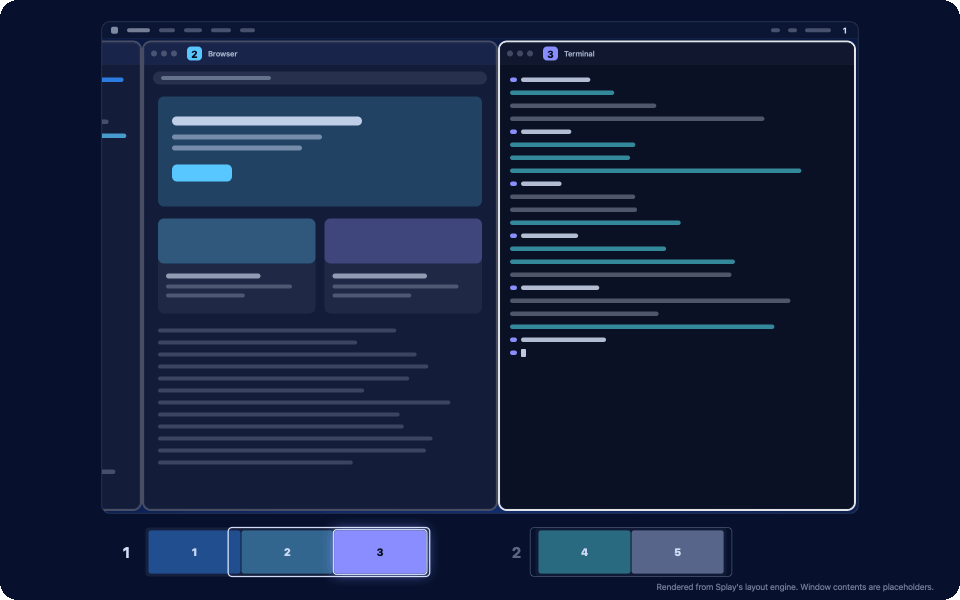

<p align="center">
  
</p>

<h1 align="center">Splay</h1>

<p align="center">
  A scrolling tiling window manager for macOS.<br>
  One scrolling row of windows per Space, driven from the keyboard.
</p>

<p align="center">
  <a href="https://github.com/shawntz/splay/releases/latest"></a>
  
  <a href="LICENSE"></a>
</p>

<p align="center">
  <a href="https://github.com/shawntz/splay/releases/latest/download/Splay.app.zip"><b>Download</b></a> ·
  <a href="https://shawntz.github.io/splay/">Website</a> ·
  <a href="https://shawntz.github.io/splay/start/">Manual</a> ·
  <a href="https://shawntz.github.io/splay/changelog/">Changelog</a>
</p>

<p align="center">
  <picture>
    <source media="(prefers-reduced-motion: reduce)" srcset="docs/assets/demo/strip-poster.png">
    
  </picture>
  <br>
  <sub>The animations on this page are rendered from Splay's layout engine.</sub>
</p>

Splay puts the windows on each Space in one row of columns that runs past the edges of the display.
A new window opens beside the one you're in at its own width, and the row grows sideways. It is
the niri and PaperWM idea on a Mac, with System Integrity Protection left on.

## Why Splay

- **Every workspace scrolls.** The strip is the layout from the first launch, with nothing to configure.
- **Option, Command and the arrows walk it.** <kbd>Alt</kbd>+<kbd>Cmd</kbd>+<kbd>←</kbd> and <kbd>→</kbd> step one
  column, and so do <kbd>Alt</kbd>+<kbd>H</kbd> and <kbd>L</kbd>. <kbd>Alt</kbd>+<kbd>Cmd</kbd>+<kbd>Home</kbd>
  and <kbd>End</kbd> jump to either end.
- **Widths on one key.** <kbd>Alt</kbd>+<kbd>R</kbd> cycles a third, a half and two
  thirds. <kbd>Alt</kbd>+<kbd>M</kbd> maximizes and restores. <kbd>Alt</kbd>+<kbd>C</kbd> centres.
- **Focus remembers.** Go back to a column and you land on the window you left there.
- **The view holds still.** When another column closes or resizes, the one you're looking at stays in view.
- **Fast presses keep up.** Each press of <kbd>Alt</kbd>+<kbd>Cmd</kbd>+<kbd>→</kbd> steps one column, without
  waiting for macOS to catch up.
- **Rules size windows.** `run = 'column-width 0.66'` opens an app at two thirds of the screen.
- **Updates in one click.** Releases are signed, notarized and universal, and Splay offers each new
  one in the app.

<p align="center">
  <picture>
    <source media="(prefers-reduced-motion: reduce)" srcset="docs/assets/demo/widths-poster.png">
    
  </picture>
</p>

## Install

```sh
brew install --cask shawntz/tap/splay
```

This puts Splay in Applications and links the `splay` command. Or download
[Splay.app.zip](https://github.com/shawntz/splay/releases/latest/download/Splay.app.zip), unzip it
and drag Splay to Applications. Then open Splay. New versions are offered in the app, and Check for
Updates is in its menu. When Splay finds one on its own, `↑` appears after the workspace number in
the menu bar.

Splay asks for Accessibility on first launch. Once you allow it, it tiles every open window into
the strip, and the keys it binds stop reaching apps. Quit from the menu bar and every open
window goes back where it was.
[Get started](https://shawntz.github.io/splay/start/) covers the first run, the two macOS settings
Splay asks about, and how to remove it.

<details>
<summary>Build from source</summary>

You need Xcode 26 or later.

```sh
git clone https://github.com/shawntz/splay.git
cd splay
scripts/bundle.sh
open build/Splay.app
```

</details>

## Keys

Alt is the Option key and Cmd is the Command key. Every binding is in `~/.config/splay/splay.toml`.

| Keys | Does |
| --- | --- |
| <kbd>Alt</kbd>+<kbd>Cmd</kbd>+<kbd>←</kbd> <kbd>→</kbd>, or <kbd>Alt</kbd>+<kbd>H</kbd> <kbd>L</kbd> | Focus the column to the left or right |
| <kbd>Alt</kbd>+<kbd>Cmd</kbd>+<kbd>Home</kbd> <kbd>End</kbd> | Focus the first or last column |
| <kbd>Alt</kbd>+<kbd>J</kbd> <kbd>K</kbd> | Focus down or up within a column |
| <kbd>Alt</kbd>+<kbd>Shift</kbd>+<kbd>H</kbd> <kbd>J</kbd> <kbd>K</kbd> <kbd>L</kbd> | Move the window left, down, up or right |
| <kbd>Alt</kbd>+<kbd>R</kbd>, <kbd>Alt</kbd>+<kbd>Shift</kbd>+<kbd>R</kbd> | Next or previous preset width |
| <kbd>Alt</kbd>+<kbd>M</kbd> | Maximize the column, or restore it |
| <kbd>Alt</kbd>+<kbd>C</kbd> | Centre the column |
| <kbd>Alt</kbd>+<kbd>F</kbd> | Fill the workspace with the window |
| <kbd>Alt</kbd>+<kbd>Shift</kbd>+<kbd>F</kbd> | Float the window, or tile it again |
| <kbd>Ctrl</kbd>+<kbd>←</kbd> <kbd>→</kbd> | Previous or next workspace |
| <kbd>Alt</kbd>+<kbd>1</kbd> to <kbd>9</kbd> | Go to a workspace |
| <kbd>Alt</kbd>+<kbd>Shift</kbd>+<kbd>1</kbd> to <kbd>9</kbd> | Send the window to a workspace |

While Splay runs, these keys belong to it. In Chrome and Firefox,
<kbd>Option</kbd>+<kbd>Command</kbd>+<kbd>←</kbd> and <kbd>→</kbd> walk the strip instead of switching tabs.
<kbd>Option</kbd>+<kbd>L</kbd> no longer types @ on a German layout, or ł on a Polish one. To hand a key
back to an app, list the app under `exclude-apps`. To keep the right Option key for typing, set
`alt = 'left'` under `[modifiers]`. To free Option-H and Option-L, delete the `alt-h` and `alt-l` lines.
[Keys](https://shawntz.github.io/splay/start/#keys) in the manual shows each.

## Configure

Splay writes `~/.config/splay/splay.toml` on first run, with every setting and binding in it, and
applies changes when you save. Edit its `[scrolling]` table, and add rules below it:

```toml
[scrolling]
column-width = 0.49                      # a new column's share of the display
preset-column-widths = [0.33333, 0.5, 0.66667]
center-focused-column = 'never'          # or 'always', 'on-overflow'
peek = 25                                # points of an off-screen column left showing

[[rules]]
app-id = 'com.apple.Safari'
run = 'column-width 0.66'
```

Every command also runs from a terminal, a script or a bar such as SketchyBar, once the `splay`
command is linked as [Get started](https://shawntz.github.io/splay/start/#install) shows:

```sh
splay column-width 0.75
splay focus-column last
splay list-windows --workspace 2
```

The manual lists every [setting](https://shawntz.github.io/splay/configuration/) and
[command](https://shawntz.github.io/splay/commands/).

## More than the strip

<p align="center">
  <picture>
    <source media="(prefers-reduced-motion: reduce)" srcset="docs/assets/demo/workspaces-poster.png">
    
  </picture>
</p>

- Workspaces are native macOS Spaces, each with its own strip, and switching skips the half-second macOS slide.
- Any workspace can use another layout: dwindle, master, a fixed grid or an accordion.
- Window rules float, place or size windows by app, title or kind.
- Focus borders, focus follows mouse, and dragging to rearrange.
- `splay doctor` checks your config and the macOS settings Splay relies on.

## Splay and Dinky

Splay is a fork of [Dinky](https://github.com/mikker/Dinky) by Mikkel Malmberg, and it keeps merging
Dinky's changes. Dinky tiles in a dwindle layout by default and offers a scrolling strip as an
option. Splay is built around the strip.

<p align="center">
  <picture>
    <source media="(prefers-reduced-motion: reduce)" srcset="docs/assets/demo/versus-poster.png">
    
  </picture>
  <br>
  <sub>Rendered from the layout engine the two share.</sub>
</p>

| | Dinky | Splay |
| --- | --- | --- |
| Default layout | Dwindle tiles | Scrolling strip |
| Move between columns | <kbd>Alt</kbd>+<kbd>H</kbd> <kbd>L</kbd> | <kbd>Alt</kbd>+<kbd>Cmd</kbd>+<kbd>←</kbd> <kbd>→</kbd>, and <kbd>Alt</kbd>+<kbd>H</kbd> <kbd>L</kbd> |
| Jump to the first or last column | No | <kbd>Alt</kbd>+<kbd>Cmd</kbd>+<kbd>Home</kbd> <kbd>End</kbd> |
| Preset column widths | No | <kbd>Alt</kbd>+<kbd>R</kbd> cycles a list you set |
| Set a column's width | <kbd>Alt</kbd>+<kbd>-</kbd> <kbd>=</kbd>, 50 points a step | Any share, `column-width 0.75` |
| Maximize a column | Fullscreen, until focus moves | Holds until you toggle it back |
| Centre a column on demand | No | <kbd>Alt</kbd>+<kbd>C</kbd>, or always, or on overflow |
| Sliver left by off-screen columns | 25 points | 1 to 100 points |

Dinky's other layouts, workspaces, rules, hooks and command line are all in Splay. The two install
side by side with separate configs. Run one at a time.

## Status

Splay is new. It is built for macOS 15 or later and developed on macOS 27. To switch Spaces
quickly it uses a few private macOS APIs, as Dinky does, so a macOS update can break it until a fix
ships. Report bugs in [this repository's issues](https://github.com/shawntz/splay/issues), not
Dinky's.

## Develop

```sh
swift build
swift test
scripts/bundle.sh --debug    # build/Splay.app
scripts/sync-upstream.sh     # merge Dinky's latest, without committing
```

[RELEASING.md](RELEASING.md) covers cutting a release. `Tools/DemoReel` renders the animations on
this page from the layout engine. `PLAN.md`, `RESEARCH.md`, `RESULTS.md`, `CHANGELOG.md` and
`.tickets/` are Dinky's own working notes, kept unchanged so merges stay clean.

## Credits

- [Dinky](https://github.com/mikker/Dinky) by Mikkel Malmberg, which Splay is forked from (MIT).
- [niri](https://github.com/niri-wm/niri) and [PaperWM](https://github.com/paperwm/PaperWM), whose
  scrolling model Splay follows. Splay has none of their code.
- The other projects Splay's code draws on are in [THIRD_PARTY_NOTICES.md](THIRD_PARTY_NOTICES.md).

## Licence

MIT. See [LICENSE](LICENSE).
